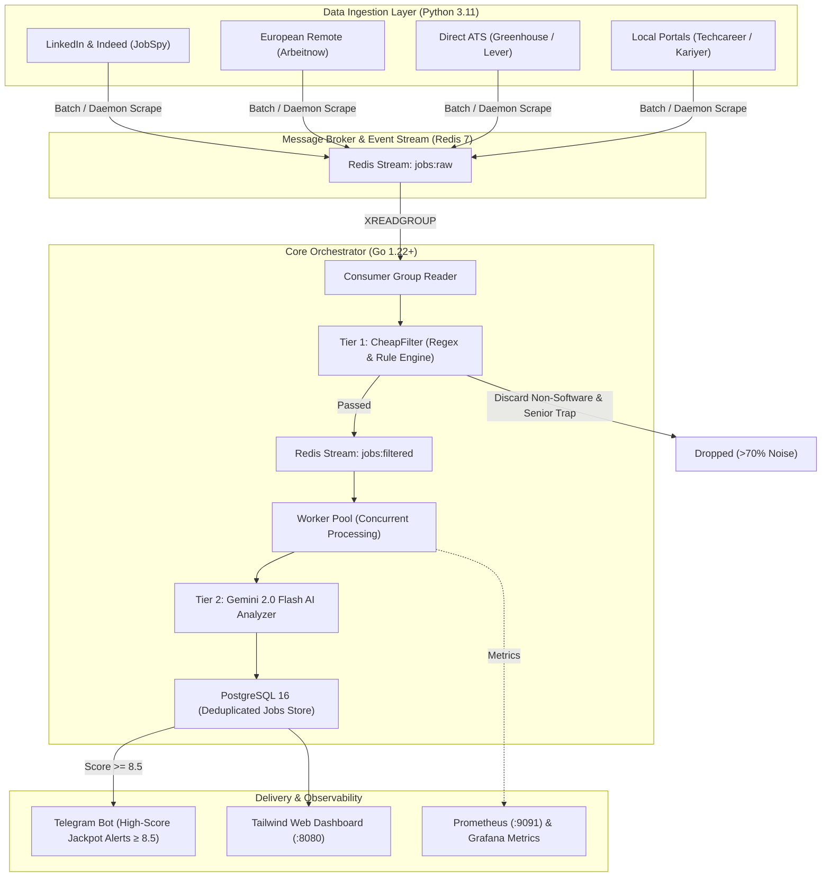

# 🎯 Job Hunter — Autonomous AI-Powered Job Search & Matchmaking Engine

[](https://golang.org)
[](https://python.org)
[](https://redis.io)
[](https://www.postgresql.org)
[](https://ai.google.dev/)
[](https://www.docker.com)
[](LICENSE)

An event-driven, distributed job scraping and intelligent matchmaking engine designed to aggregate tech opportunities across Europe and Turkey, eliminate recruitment noise with a dual-stage filtering pipeline, and evaluate candidate-job fit using Google Gemini 2.0 Flash.

---

## 🏛️ System Architecture



---

## ✨ Key Features

### 1. Dual-Stage Intelligent Filtering Pipeline
* **Tier 1 — CheapFilter (Zero Cost, Microsecond Latency)**:
  * Eliminates non-software engineering disciplines (*Civil, Mechanical, Chemical, Environmental, etc.*).
  * Blocks explicit senior titles (*Kıdemli, Başmühendis, Takım Lideri, Tech Lead, Engineering Manager, Architect*).
  * **Protects Turkish MT / New Grad entries**: Differentiates and preserves `Uzman Yardımcısı` (Management Trainee) while safely dropping `Kıdemli Uzman`.
  * Filters out >70% of raw market noise before hitting AI models, drastically reducing LLM token consumption.
* **Tier 2 — AI Evaluator (Google Gemini 2.0 Flash / Groq Llama 3.3)**:
  * Deep evaluation with up to **3,500 UTF-8 characters** per job posting.
  * Strict scoring matrix (0.0 to 10.0), classification (`apply`, `watch`, `skip`), match reasoning, missing technical skills, and candidate red flags.
  * **Stealth Seniority Detection**: Automatically identifies postings that omit numeric year limits but implicitly demand end-to-end architectural leadership or senior mentoring, scoring them below 4.5.

### 2. Multi-Hub European & Regional Sourcing
* **Primary Tech Hubs**:
  * 🇧🇪 **Brussels, Belgium**: Local European traineeship and EU agency ecosystem.
  * 🇳🇱 **Amsterdam, Netherlands**: High English-speaking adoption and international tech scene.
  * 🇩🇪 **Berlin & Munich, Germany**: Leading European startup and software engineering hubs.
  * 🇹🇷 **Istanbul, Turkey**: Top enterprise tech companies, banks, and fast-growing tech ventures.
* **Smart Language Gatekeeper**: Flags mandatory French/Dutch requirements where English is not accepted.

### 3. The 4 Core Engineering Target Pillars
The AI evaluator aligns candidate profiles across four primary technical career tracks:
1. **Backend Engineering**: Go, Java (Spring), Python, Rust, REST APIs, microservices, concurrency.
2. **Cloud / DevOps / SRE**: Docker, Kubernetes, Linux internals, CI/CD pipelines, cloud infrastructure.
3. **Data Engineering & Analytics**: Data Analyst, Data Scientist, Data Engineer, SQL/NoSQL, distributed data pipelines.
4. **Aerospace & Mission-Critical Systems**: Surveillance/radar decoding (ASTERIX), distributed systems, C++/Python.

### 4. Interactive Modern Web Dashboard
* Built with embedded HTML5 and Tailwind CSS.
* **Category Tabs**: All Jobs, Backend, Cloud & DevOps, Data & Analytics, and Regional Hubs.
* **Score Filter**: Quick toggle `🎯 Sadece Uygunlar (≥ 5.0)` to instantly hide skipped postings.
* **Batch Maintenance**: One-click bulk delete and clearing controls.

### 5. Smart Telegram Alerts
* Avoids spam by alerting only on **Jackpot matches (Score ≥ 8.5)** with company, position, score, direct link, and match reasoning.

---

## 🚀 Getting Started

### Prerequisites
* [Docker & Docker Compose](https://www.docker.com/)
* [Go 1.22+](https://golang.org/dl/)
* [Python 3.11+](https://www.python.org/downloads/)
* A Google Gemini API Key (or Groq API Key)

### 1. Clone & Setup Environment

```bash
git clone https://github.com/ulasdursun/job-hunter.git
cd job-hunter
cp .env.example .env
```

Edit `.env` and fill in your credentials:
```env
# AI Provider Credentials
AI_PROVIDER=gemini                     # 'gemini' or 'groq'
GEMINI_API_KEY=your_gemini_api_key
GROQ_API_KEY=your_groq_api_key

# Telegram Notifications
TELEGRAM_BOT_TOKEN=your_bot_token
TELEGRAM_CHAT_ID=your_chat_id

# Database & Redis (Defaults match docker-compose.yml)
POSTGRES_HOST=localhost
POSTGRES_PORT=5433
POSTGRES_DB=jobhunter
POSTGRES_USER=jobhunter
POSTGRES_PASSWORD=jobhunter
REDIS_HOST=localhost
REDIS_PORT=6379
```

### 2. Start Infrastructure (PostgreSQL, Redis, Prometheus)

```bash
docker compose up -d
```

Verify that all containers are healthy:
```bash
docker compose ps
```

### 3. Install Python Scraper Dependencies

```bash
cd scraper
python -m venv .venv

# Windows PowerShell:
.\.venv\Scripts\Activate.ps1
# Linux/macOS:
# source .venv/bin/activate

pip install -r requirements.txt
cd ..
```

### 4. Build & Run the Go Orchestrator

```bash
# Build the binary
go build -o bin/orchestrator.exe ./cmd/orchestrator

# Run orchestrator
.\bin\orchestrator.exe
```

The orchestrator will start:
* **Web Dashboard**: [http://localhost:8080](http://localhost:8080)
* **Metrics Endpoint**: [http://localhost:9091/metrics](http://localhost:9091/metrics)

### 5. Run Scrapers

Execute a one-time batch scrape across all configured platforms and locations:
```bash
python -m scraper.main --once
```

Or run the continuous automated background scheduler:
```bash
python -m scraper.main
```

---

## 📂 Project Structure

```text
├── cmd/
│   └── orchestrator/       # Go service entrypoint (Stream consumer, workers, web server)
├── internal/
│   ├── analyzer/           # Gemini & Groq LLM integration and dynamic prompt generator
│   ├── api/                # REST API handlers and embedded static dashboard server
│   ├── config/             # YAML and environment variable configuration loader
│   ├── consumer/           # Redis Streams consumer group logic
│   ├── filter/             # Microsecond-latency CheapFilter regex engine
│   ├── intelligence/       # Market trend analytics and scheduled reporting
│   ├── metrics/            # Prometheus operational telemetry
│   ├── notifier/           # Telegram bot notifier for high-score matches
│   ├── store/              # PostgreSQL store with automatic schema migrations
│   └── worker/             # Concurrent worker pool processing filtered jobs
├── scraper/
│   ├── models/             # Pydantic data schemas
│   ├── publisher/          # Redis Streams message producer
│   └── sources/            # Sourcing modules: JobSpy (LinkedIn/Indeed), Arbeitnow, ATS, etc.
├── web/
│   └── index.html          # Clean Tailwind CSS responsive dashboard
├── config.yaml             # Search keywords, locations, blacklists, and scoring parameters
├── docker-compose.yml      # PostgreSQL 16, Redis 7, Prometheus, Grafana definitions
└── prometheus.yml          # Prometheus metrics scraping configuration
```

---

## 🔮 Strategic Roadmap & Future Vision

* [ ] **Tailored Resume & Cover Letter Generator**: Automatic one-click generation of ATS-optimized LaTeX resumes and personalized cover letters aligned with the job posting requirements (`/api/jobs/:id/tailor`).
* [ ] **Application Lifecycle Kanban CRM**: Interactive dashboard board (`Applied` ➔ `Screening` ➔ `Interview` ➔ `Offer` ➔ `Rejected`) to monitor application stages.
* [ ] **Headless ATS Automation**: Semi-automated browser filling for Greenhouse, Lever, and LinkedIn Easy Apply forms via Playwright.
* [ ] **Market Intelligence & Tech Stack Analytics**: Weekly aggregated insights on hiring trends, required cloud tooling, and salary benchmarks across Europe.
* [ ] **Single-Node Cloud Deployment**: Production deployment template for lightweight VPS hosting (e.g. Hetzner Cloud) for 24/7 autonomous monitoring.

---

## 📄 License

Distributed under the MIT License. See [LICENSE](LICENSE) for more information.

---

**Developed with ❤️ by [Ulaş Dursun](https://github.com/ulasdursun)**
