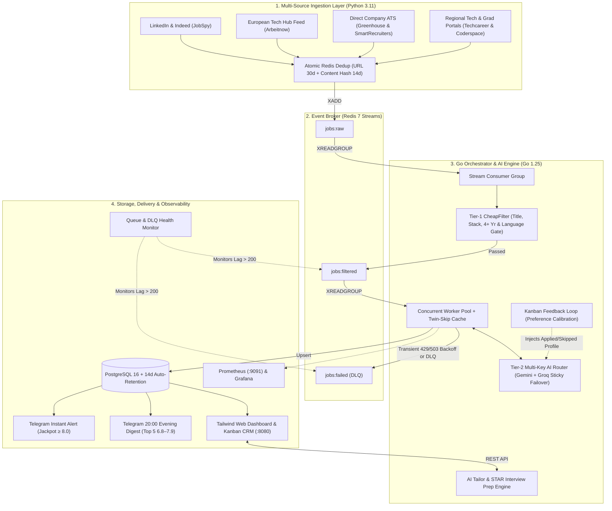

# 🎯 Job Hunter — Autonomous Event-Driven AI Career & Job Intelligence Platform

[](https://go.dev)
[](https://python.org)
[](https://redis.io)
[](https://www.postgresql.org)
[](https://ai.google.dev/)
[](https://www.docker.com)
[](LICENSE)
[](https://github.com/sponsors/Ulas-Dursun)

**Job Hunter** is a distributed, event-driven job aggregation, scoring, and career-ops platform built with **Go**, **Python**, **Redis Streams**, and **PostgreSQL**. It continuously harvests software, cloud/DevOps, data/AI, and aerospace engineering roles across **Europe and Turkey**, filters out >70% of recruitment noise in microseconds before touching an LLM quota, and provides **preference-aware AI scoring, hallucination-safe resume tailoring, STAR interview preparation, and a full Kanban CRM**.

---

## 🏛️ System Architecture



---

## ✨ Why Job Hunter Stands Out

### 1. Zero-Waste Dual-Stage Filtering Pipeline
* **Cross-Platform Atomic Deduplication (Python → Redis)**:
  * Combines **URL hash (`30d TTL`)** and normalized **`company + title + city` content hash (`14d TTL`)** via atomic `SET NX EX` so identical postings scraped from LinkedIn, Indeed, and company ATS boards are published only once.
* **Tier 1 — Deterministic `CheapFilter` (Go, Microsecond Latency, Zero Token Cost)**:
  * **Soft 0–2 Year / New Grad Gate**: Welcomes broad entry-level opportunities (*Software, Backend, Cloud/DevOps, Data Analyst, Data Scientist, ML/AI, BI, Systems/Solutions Engineer, Graduate Programmes*) when backed by concrete technical terms.
  * **Hard Seniority & Corporate Noise Blocker**: Drops `4+ years` requirements (while ignoring company-age claims like *"Over 20 years of experience"*), senior/management titles, non-software corporate roles (*FinCrime, Operational Risk, Product Cost Analyst, Sales/HR*), and non-EUROCONTROL internships.
  * **Deterministic Language Gatekeeper**: Detects mandatory German/Dutch/French requirements (`Deutsch C1`, `vloeiend Nederlands`) and non-English job descriptions via stop-word ratio analysis while preserving English-friendly bilingual postings.
  * **Low-Score Twin Suppression**: Skips LLM calls when the exact same `company + title` (e.g., multi-city duplicate postings) already scored `< 5.0` in the last 30 days.

### 2. Multi-Key Sticky AI Failover & Granular Scoring Matrix
* **8-Endpoint Sticky Cursor Rotation**: Rotates across multiple **Google Gemini** and **Groq / OpenAI-compatible** API keys and models. When an endpoint hits HTTP `429`/`503`, the atomic cursor advances immediately to the next healthy key; if all endpoints are temporarily saturated, jobs remain safely in Redis pending state with exponential backoff instead of being lost.
* **Self-Calibrating Kanban Feedback Loop**: Periodically queries your real `applied / interview / offer` vs. `skipped / rejected` decisions from PostgreSQL and injects your historical preference profile into the scoring prompt.
* **Anti-Clustering Granular Rubric**: Separates `8.0+` (Jackpot Apply), `7.0–7.9` (Strong Apply), `6.8–7.3` (0–2 yr High Watch), and `5.8–6.5` (3+ yr Mid-Level Stretch).

### 3. Hallucination-Safe CV Tailor & STAR Interview Prep Kit
* **Language-Aware Generation**: Automatically writes cover letters and CV bullets in **Turkish** for Turkish postings and **English** for international postings.
* **Recruiter-Ready Brevity**: Generates concise **130–170 word (3-paragraph)** cover letters and **≤ 22-word** high-impact CV bullet points grounded strictly in the candidate's verified profile.
* **Deterministic Anti-Hallucination Sanitizer**: Post-processes LLM output to strip unowned technologies from `skills_highlight` and explicitly flags missing tools in `ats_keywords` with `⚠ (gap — do not claim on CV)`.
* **One-Click Interview Prep Kit**: Generates **3 role-specific technical questions** (with *Why They Ask* + *Answer Strategy*), **2 behavioral STAR stories** mapped to real candidate projects, and **reverse questions** for the interviewer. Automatically pre-generates in the background when a job card is moved to `Interview`.

### 4. Two-Tier Telegram Notifications & System Health Guard
* **Instant Jackpot Alerts (`≥ 8.0`)**: Real-time push notification for top-tier entry-level matches.
* **Daily 20:00 Evening Digest (`6.8 – 7.9`)**: Summarizes the top 5 unnotified opportunities of the day in a single evening message—zero notification fatigue.
* **Autonomous Queue & DLQ Monitor**: Alerts via Telegram if `jobs:filtered` backlog exceeds `200` or if new failures appear in `jobs:failed`.

### 5. Interactive Web Dashboard & Kanban CRM
* **9 Smart Category Views**: *All, Top Matches (≥ 7.5), Junior / 0–2 Yıl, Backend (Go/Java/Py), DevOps & Cloud, Data/ML & AI, Istanbul & TR, Brussels & Europe, Direct Company ATS*.
* **Drag-and-Drop Kanban Board + 1-Click Triage**: Instant `📨 Başvurdum` and `⏭ Geç` buttons on every card in both Feed and Kanban views.
* **Hardened Local API**: Protected against DNS rebinding, cross-origin state mutations, oversized payloads, and duplicate concurrent LLM calls (`singleflight`-style per-job lock).

---

## 🚀 Getting Started

### Prerequisites
* [Docker & Docker Compose](https://www.docker.com/)
* [Go 1.25+](https://go.dev/dl/)
* [Python 3.11+](https://www.python.org/downloads/)
* At least one [Google Gemini API Key](https://aistudio.google.com/) or [Groq API Key](https://console.groq.com/)

### 1. Clone & Configure Environment

```bash
git clone https://github.com/Ulas-Dursun/job-hunter.git
cd job-hunter
cp .env.example .env
cp config.yaml config.local.yaml
```

* **Customize Your Candidate Profile**: Edit `config.local.yaml` (git-ignored for privacy) or `config.yaml` with your `name`, `education`, `experience`, `projects`, `skills`, `target_roles`, and `locations`. Both the Go orchestrator and Python scraper automatically prefer `config.local.yaml` when present, keeping your personal CV details private.
* **Set Your API Keys**: Edit `.env` with your API keys (multiple comma-separated keys are supported for automatic failover):
```env
AI_PROVIDER=gemini
GEMINI_API_KEY=your_primary_key,your_backup_key
GROQ_API_KEY=your_groq_key_1,your_groq_key_2

TELEGRAM_BOT_TOKEN=your_bot_token
TELEGRAM_CHAT_ID=your_chat_id

POSTGRES_HOST=localhost
POSTGRES_PORT=5433
POSTGRES_DB=jobhunter
POSTGRES_USER=jobhunter
POSTGRES_PASSWORD=jobhunter
REDIS_HOST=localhost
REDIS_PORT=6379
```

### 2. Start Infrastructure (PostgreSQL 16, Redis 7, Prometheus, Grafana)

```bash
docker compose up -d
```

### 3. Install Python Scraper Dependencies

```bash
python -m venv .venv
# Windows PowerShell:
.\.venv\Scripts\Activate.ps1
# Linux / macOS:
# source .venv/bin/activate

pip install -r scraper/requirements.txt
```

### 4. Run the Orchestrator & Scrapers

Run a full batch (scrapers + Go orchestrator) on Windows PowerShell:
```powershell
.\run_batch.ps1
```

Or run the Go orchestrator and Python scraper independently:
```powershell
# Start Go Orchestrator + Web Dashboard (http://127.0.0.1:8080)
go run ./cmd/orchestrator

# Run a single scrape pass across all enabled sources
.\.venv\Scripts\python.exe -m scraper.main --once
```

### 5. Run Tests

```powershell
# Go unit tests (analyzer, api security guard, deterministic filters)
go test -count=1 ./...

# Python filter unit tests
.\.venv\Scripts\python.exe -m unittest discover -s scraper/tests -t .
```

---

## 📂 Project Structure

```text
├── cmd/orchestrator/           # Go entrypoint (Redis consumer, worker pool, HTTP server, schedulers)
├── internal/
│   ├── analyzer/               # Multi-key Gemini/Groq failover, scoring rubric, Tailor & Interview Prep
│   ├── api/                    # Hardened REST API handlers, repository, and localhost security guard
│   ├── config/                 # YAML + .env configuration loader
│   ├── consumer/               # Redis Streams consumer group reader (jobs:raw -> jobs:filtered)
│   ├── filter/                 # Tier-1 CheapFilter + language/seniority/experience signal detectors
│   ├── intelligence/           # Weekly market analytics, 20:00 Evening Digest & Queue Health Monitor
│   ├── metrics/                # Prometheus operational metrics
│   ├── notifier/               # Telegram HTML notification client
│   ├── store/                  # PostgreSQL store, Kanban preference builder & 14d retention cleaner
│   └── worker/                 # Concurrent scoring worker pool with transient retry & twin suppression
├── scraper/
│   ├── models/                 # Normalized Job schema (URL & cross-source content hashing)
│   ├── publisher/              # Atomic Redis Streams producer with TTL deduplication
│   ├── sources/                # JobSpy (LinkedIn/Indeed), Greenhouse, SmartRecruiters, Arbeitnow, Techcareer, Coderspace
│   └── tests/                  # Python unit test suite
├── web/index.html              # Single-page Tailwind CSS dashboard, Kanban CRM & AI Tailor modal
├── config.yaml                 # Plug-and-play candidate profile template, ATS watchlist & scoring thresholds
└── docker-compose.yml          # PostgreSQL 16, Redis 7, Prometheus & Grafana stack
```

---

## 💖 Support & Sponsorship

If **Job Hunter** helps you land interviews, save hours of manual job board filtering, or serves as a reference architecture for your own Go + Python event-driven systems:

* ⭐ **Star this repository** on GitHub to help more engineers discover it!
* 💖 **[Sponsor on GitHub](https://github.com/sponsors/Ulas-Dursun)** to support ongoing open-source development.

---

## 📄 License

Distributed under the MIT License. See [LICENSE](LICENSE) for more information.

---

**Developed by [Ulaş Dursun](https://github.com/Ulas-Dursun)**
